<div align="center">


<br/>

<a href="https://chakrabortysohini2005-stack.github.io/CLIMO-Web-Mobile-Application/"></a>
<a href="docs/GALLERY.md"></a>
<a href="https://github.com/chakrabortysohini2005-stack/CLIMO-Web-Mobile-Application/actions/workflows/android.yml"></a>


<h3>🌦️ A live, map-first weather &amp; flood-risk observatory for all of India,<br/>running in any browser and as an Android app.</h3>

<b>Observe.</b> &nbsp;/&nbsp; <b>Alert.</b> &nbsp;/&nbsp; <b>Navigate.</b>

<br/><br/>

<a href="#gallery">Gallery</a> •
<a href="#features">Features</a> •
<a href="#how-it-works">How it works</a> •
<a href="#risk-index">Risk index</a> •
<a href="#quick-start">Quick start</a> •
<a href="#android-apk">Android APK</a> •
<a href="#documentation">Docs</a>

</div>

---

## 🌏 What is CLIMO?

**CLIMO** turns raw weather into **decisions**. It watches **90 weather stations** across **33 states and union territories**. For each one it computes a live **flood-risk score from 0 to 100** and shows it on an interactive GIS map. It also tells you what that score means for *you*: whether to carry an umbrella, whether your route is safe, and whether your area needs an alert.

<table>
<tr>
<td width="50%" valign="top">

### Built for the street, not just the sky

- 🛰️ **90 live observatories**: AWS, radar, rain-gauge and river-gauge stations
- 🌊 **Flood-risk index** from rainfall over the last 24 h and 6 h, current intensity, rain probability and thunderstorm signals
- 🧭 **Weather-safe routing** that draws a detour around storm cells, next to the shortest route
- 🕰️ **Time machine**: scrub 48 h of history plus 10 days of forecast, or play **2000 → 2030** climate heatmaps (LSTM forecast)
- 🤖 **CLIMO Copilot**, an on-device chat assistant that needs no API key
- 🗣️ **16 Indian languages**, from Hindi and Bengali to Sanskrit and Konkani
- 📱 **One codebase** that runs as a responsive web app and an Android APK built by CI

</td>
<td width="50%" valign="top">

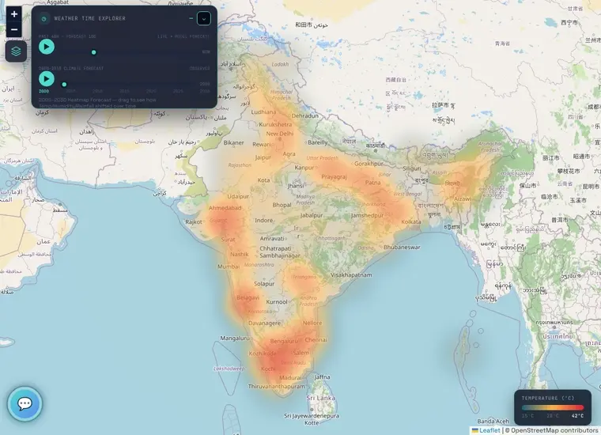
<p align="center"><sub><b>2000 → 2030 temperature heatmap</b> from the built-in India Climate Pulse dataset. Years 2026 onward are the LSTM forecast.</sub></p>

</td>
</tr>
</table>

---

<a id="gallery"></a>

## 🖼️ Gallery

> Full captions and every screen: **[docs/GALLERY.md](docs/GALLERY.md)**. Interactive lightbox: **[docs/gallery/index.html](docs/gallery/index.html)**.

<table>
<tr>
<td colspan="2">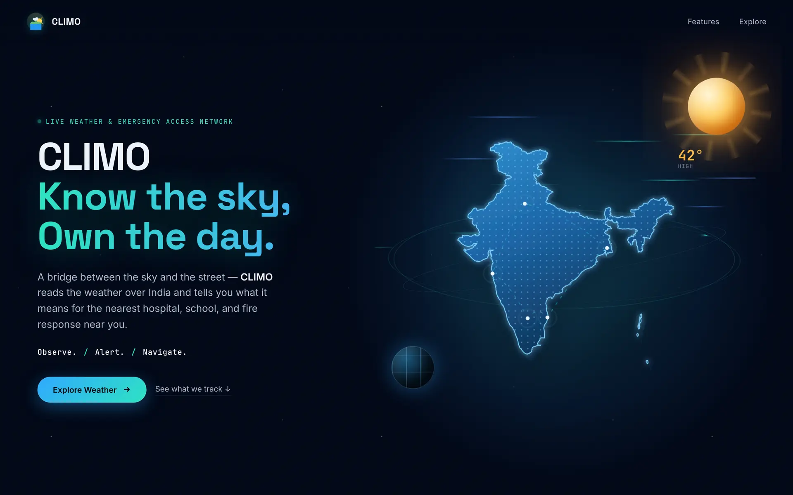<p align="center"><b>Landing</b>: a parallax 3D India with live city pins and orbiting weather rings</p></td>
</tr>
<tr>
<td width="50%">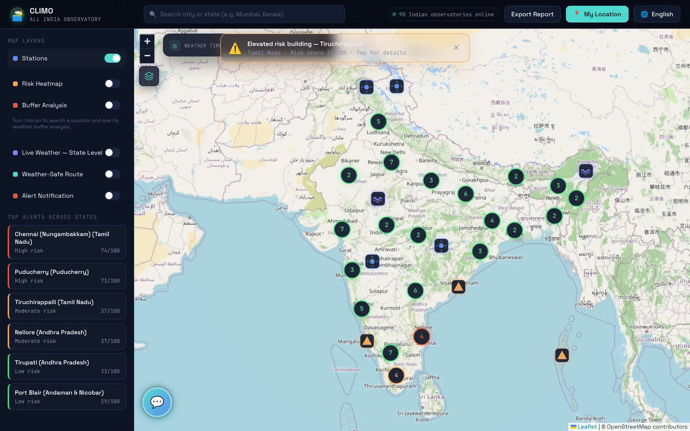<p align="center"><b>Observatory dashboard</b>: 90 stations, clustered and risk-ranked</p></td>
<td width="50%">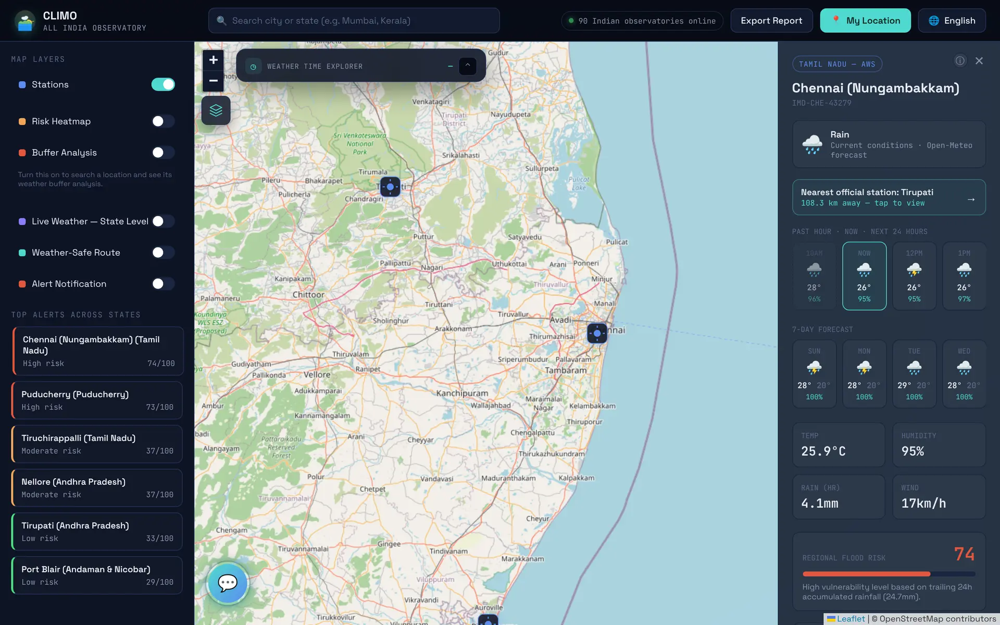<p align="center"><b>Station drawer</b>: now + 24 h, 7-day forecast, flood risk, local reports</p></td>
</tr>
<tr>
<td>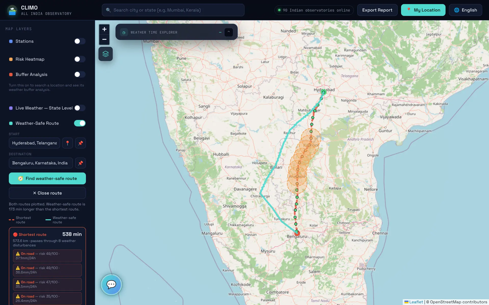<p align="center"><b>Weather-safe route</b>: the shortest route (red) compared with a detour around storm cells (teal)</p></td>
<td>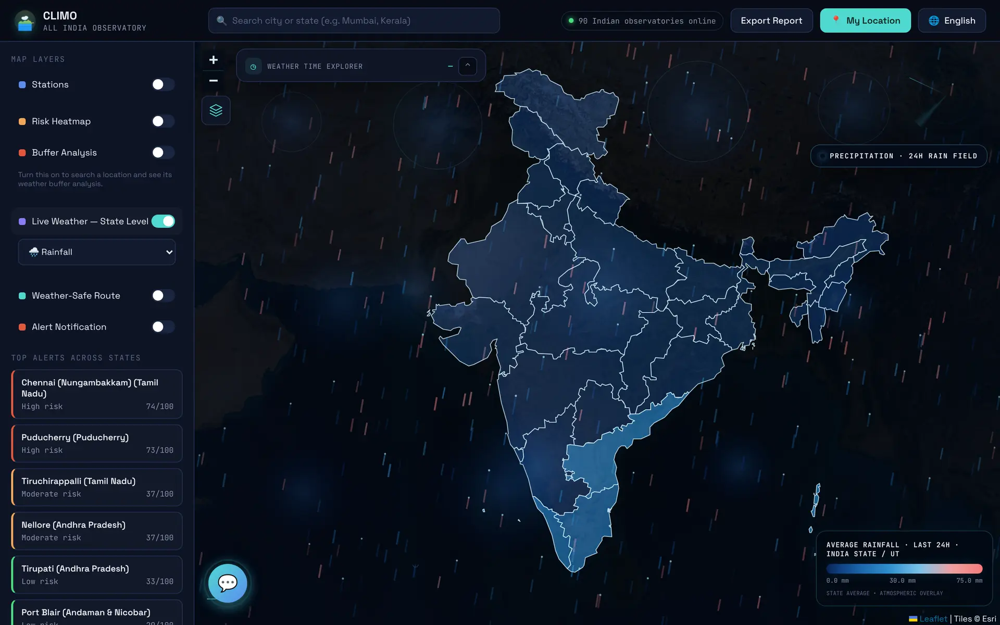<p align="center"><b>State choropleth</b>: live 24 h rainfall with an animated atmosphere</p></td>
</tr>
<tr>
<td>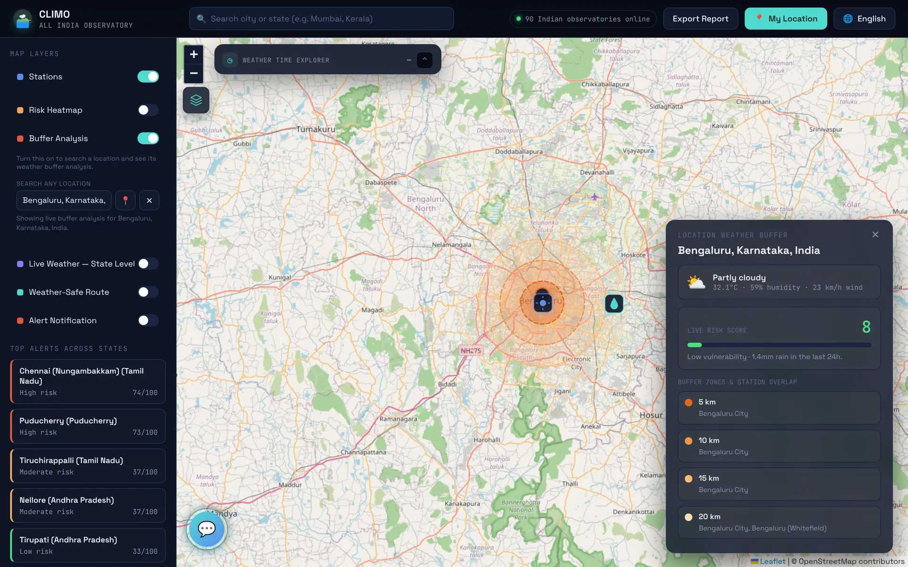<p align="center"><b>Buffer analysis</b>: 5, 10, 15 and 20 km rings with station overlap</p></td>
<td>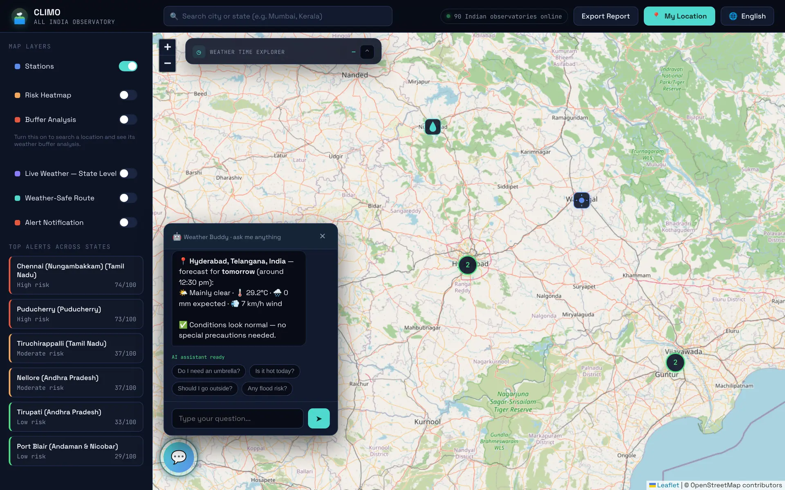<p align="center"><b>CLIMO Copilot</b>: plain-language weather answers</p></td>
</tr>
<tr>
<td>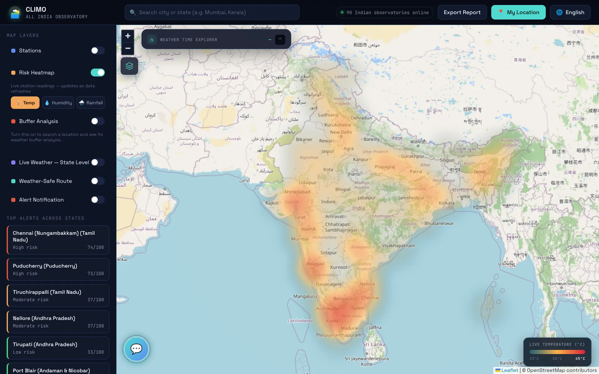<p align="center"><b>Live heatmaps</b>: temperature, humidity and rainfall</p></td>
<td>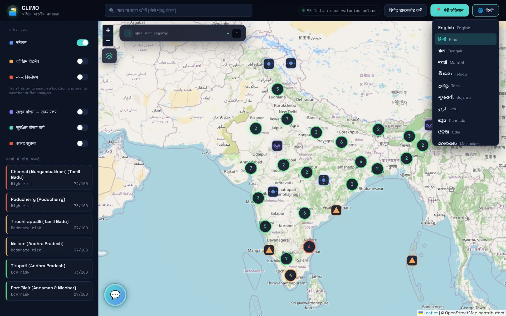<p align="center"><b>16 languages</b>: the full UI switches instantly</p></td>
</tr>
</table>

<div align="center">
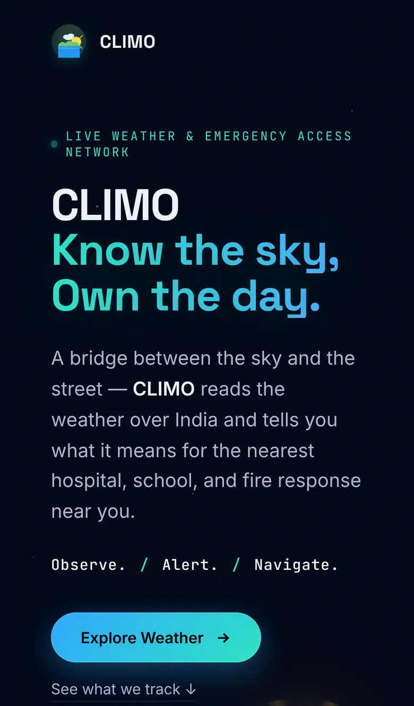
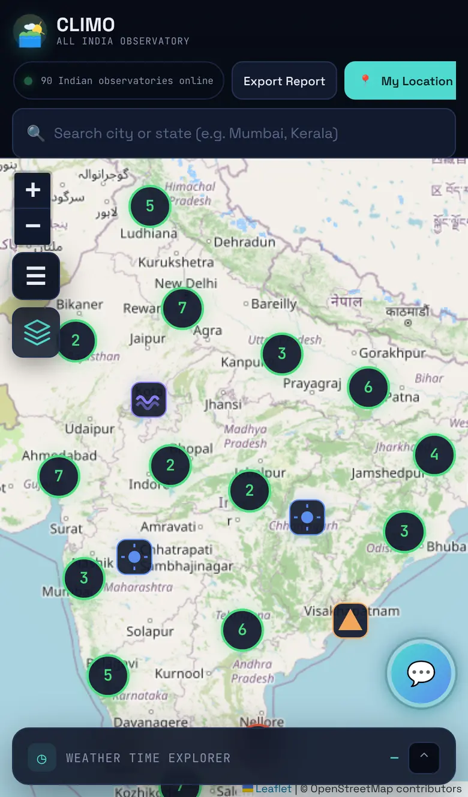
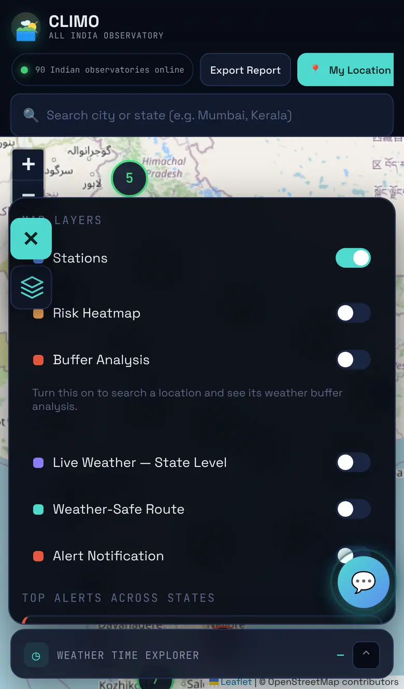
<p><sub>📱 <b>The same app on a phone</b>, with a hamburger layers drawer, a bottom time explorer and a floating Copilot</sub></p>
</div>

<sub>Screenshots are of the real app. The weather values in them come from a fixed sample dataset, because the live API was rate-limited when they were taken. See <a href="docs/GALLERY.md#how-these-screenshots-were-made">how they were made</a>.</sub>

---

<a id="features"></a>

## ✨ Features

| | Feature | What it does |
|:-:|---|---|
| 🛰️ | **Station network** | 90 IMD/WMO-coded stations in 4 sensor types, clustered with `Leaflet.markercluster`. Each type has its own icon, explained in a legend inside the drawer. |
| 🌊 | **Regional flood risk** | A 0–100 screening index for every station. It is re-checked every 5 minutes against the loaded hourly forecast. Stations are coloured 🟢 Low, 🟠 Moderate (≥ 34) or 🔴 High (≥ 66). |
| 🔔 | **Alerts** | In-app banners, native browser notifications, and an SMS pipeline (currently a demo stub, see [Security](SECURITY.md)). You pick the threshold: 34, 50 or 66. |
| 🕰️ | **Weather time explorer** | A slider covering 48 h of history plus a 10-day forecast, with play/pause. Risk is recomputed over a rolling 24-hour window. |
| 📈 | **2000 → 2030 climate heatmaps** | Year-by-year heatmaps of temperature, humidity and rainfall from the bundled *India Climate Pulse* dataset. Years 2000–2025 are observed and 2026–2030 are the LSTM forecast. |
| 🗺️ | **State choropleth** | Live temperature, rainfall, humidity or wind for each state, fetched in one batched request. A canvas animation draws rain, wind, heat or humidity on top. |
| ⭕ | **Buffer analysis** | Auto-drawn 15 km buffers around at-risk stations, plus 5/10/15/20 km rings around any place you search or your GPS position. |
| 🧭 | **Weather-safe routing** | Samples the road every 25 km and checks rainfall at each point. Storm cells become avoid-polygons sent to OpenRouteService, and the shortest and safe routes are shown side by side. |
| 📍 | **Click anywhere** | Tap any point on the map to get its live weather and risk, with the place name from reverse geocoding. |
| 🤖 | **CLIMO Copilot** | A rule-based assistant that runs in the browser. It understands questions like *“weather in Pune tomorrow”*, *“will it rain near me?”* and *“highest risk locations”*. |
| 💬 | **Local feedback** | Residents can post on-the-ground reports (waterlogging, blocked roads, power cuts) from inside each station drawer. |
| 📄 | **Export report** | Downloads a CSV of every station: temperature, humidity, rain, wind, risk label and score. It has a workaround so downloads also work in Android WebView. |
| 🌐 | **16 languages** | English, हिन्दी, বাংলা, मराठी, తెలుగు, தமிழ், ગુજરાતી, اردو, ಕನ್ನಡ, ଓଡ଼ିଆ, മലയാളം, ਪੰਜਾਬੀ, অসমীয়া, मैथिली, संस्कृतम्, कोंकणी |
| 🛰️ | **Base maps** | OpenStreetMap streets or Esri World Imagery satellite |

---

<a id="how-it-works"></a>

## ⚙️ How it works

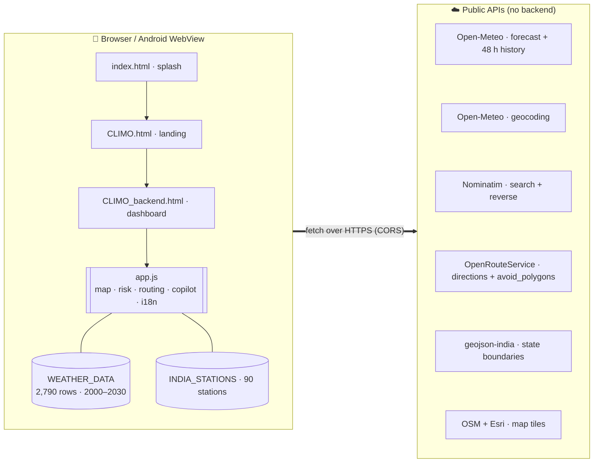

There is **no backend and no build step**. Everything runs in the client, so the same folder works:

- **opened straight from disk** (`file://`): all APIs used are CORS-enabled
- **on GitHub Pages**: the root `index.html` redirects to the app
- **inside a Cordova Android shell**, which CI builds on every push to `main`

Deep dive: **[docs/ARCHITECTURE.md](docs/ARCHITECTURE.md)**

---

<a id="risk-index"></a>

## 🌊 The flood-risk index

A transparent, weather-only **screening index**. It is not a hydrodynamic model. Each input is normalised to 0–1 and then weighted:

```text
score = 45 · min(rain_24h / 75 mm, 1)        ← trailing 24 h accumulation
      + 25 · min(rain_6h  / 35 mm, 1)        ← trailing 6 h burst
      + 10 · min(rain_now / 8 mm,  1)        ← current intensity
      + 15 · min(P(rain)_today / 80 %, 1)    ← daily precipitation probability
      +  5 · storm(WMO code)                 ← 1.0 thunderstorm (95/96/99), 0.5 showers (80–82)
```

| Score | Band | Colour | What happens |
|:-:|:-:|:-:|---|
| 0 – 33 | **Low** | 🟢 `#4ADE80` | Monitored; listed in Top Alerts if ≥ 20 |
| 34 – 65 | **Moderate** | 🟠 `#F2A65A` | Banner alert · buffer drawn · route avoid-zone |
| 66 – 100 | **High** | 🔴 `#E4573D` | All of the above, with high-severity styling |

Full methodology, including how buffers and route avoid-zones are built: **[docs/RISK_MODEL.md](docs/RISK_MODEL.md)**

---

## 📊 Inside the data

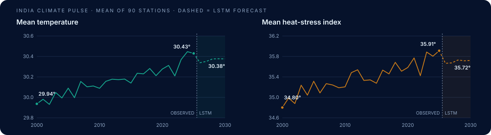

The bundled **India Climate Pulse** table has 2,790 rows: 90 stations × 31 years, with temperature, rainfall, humidity and a heat-stress index. Every station ID joins one-to-one with the live network. In this table, the 90-station mean temperature rises by **+0.49 °C** between 2000 and 2025. The LSTM forecast then levels off at about 30.4 °C.

> ⚠️ **Data-quality note.** Some values in this table do not match real climatology. For example, Leh shows a mean of 24 °C and 1,576 mm of rain a year, but Leh is a cold desert. Treat the 2000–2030 layer as a demonstration dataset until it is reconciled with IMD records. Details are in [docs/DATA.md](docs/DATA.md#data-quality-notes).

---

<a id="quick-start"></a>

## 🚀 Quick start

No install is needed. The app is plain HTML, CSS and JavaScript that loads its libraries from CDNs.

**1. Clone**

```bash
git clone https://github.com/chakrabortysohini2005-stack/CLIMO-Web-Mobile-Application.git
```

**2. Serve the folder.** Any static server works. Serving is recommended over opening the file directly because browsers only allow geolocation on `localhost` or HTTPS.

```bash
cd CLIMO-Web-Mobile-Application && python3 -m http.server 8080
```

**3. Open** <http://localhost:8080>. You will see the splash screen, then the landing page. Click **Explore Weather** to open the dashboard.

> 💡 Jump straight to the map: <http://localhost:8080/CLIMO-fixed/CLIMO-project/CLIMO_backend.html>

### Configuration

| Setting | Where | Notes |
|---|---|---|
| OpenRouteService key | `ORS_CONFIG.apiKey` in `js/app.js` | Needed for road routing. Get a free key at [openrouteservice.org](https://openrouteservice.org/dev/#/signup). Without it, routing falls back to a straight line. Read [SECURITY.md](SECURITY.md) before shipping a key. |
| Station list | `INDIA_STATIONS` in `js/app.js` | Add `{id, code, name, state, type, lat, lon}`. `type` is one of `AWS`, `rain_gauge`, `radar`, `river_gauge`. |
| Risk thresholds | `RISK_THRESHOLDS` in `js/app.js` | `{moderate: 34, high: 66}`. This is the single source of truth for colours, buffers and avoid-zones. |
| Splash duration | `js/index.js` | Defaults to 2.6 s. Tap to skip. |

---

<a id="android-apk"></a>

## 📦 Build the Android APK

Every push or PR to `main`/`master` runs **[`.github/workflows/android.yml`](.github/workflows/android.yml)**. It wraps the web app in **Apache Cordova**, builds a debug APK with JDK 17, and uploads it as the **`climo-app-debug-apk`** artifact.

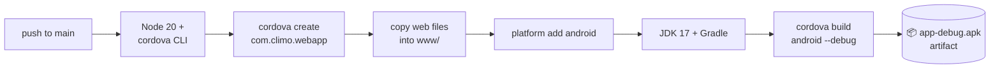

To get the APK, open **Actions → Build CLIMO Web App to APK → latest run → Artifacts**. Local builds and signing are covered in **[docs/DEPLOYMENT.md](docs/DEPLOYMENT.md)**.

---

## 🗂️ Project structure

```text
CLIMO-Web-Mobile-Application/
├── index.html                      # GitHub Pages entry: redirects into the app
├── CLIMO-fixed/CLIMO-project/
│   ├── index.html                  # Splash: starfield, logo, auto-redirect
│   ├── CLIMO.html                  # Landing: 3D India hero + features
│   ├── CLIMO_backend.html          # The GIS dashboard
│   ├── css/
│   │   ├── index.css               # splash styles
│   │   ├── climo.css               # landing styles
│   │   └── app.css                 # dashboard styles, incl. mobile layout
│   └── js/
│       ├── index.js                # splash logic
│       ├── climo.js                # landing parallax and wind streams
│       └── app.js                  # everything else: map, data, risk, routing, copilot, i18n
├── docs/                           # 📚 documentation, gallery and assets
└── .github/workflows/android.yml   # CI: Cordova → Android APK
```

---

## 🧰 Tech stack

| Layer | Technology |
|---|---|
| Map engine | **Leaflet 1.9.4**, Leaflet.markercluster 1.5.3, Leaflet.heat 0.2.0 |
| Weather | **Open-Meteo** Forecast API: current, hourly and daily, with 2 past days and 10 forecast days, in Asia/Kolkata time |
| Geocoding | Open-Meteo Geocoding (search) and **Nominatim** (reverse geocoding, area search) |
| Routing | **OpenRouteService** `driving-car` directions with `avoid_polygons` |
| Boundaries | `geojson-india@0.0.2` |
| Tiles | OpenStreetMap, Esri World Imagery |
| UI | Hand-written HTML/CSS, Canvas 2D animation, inline SVG, Space Grotesk / Inter / JetBrains Mono |
| Mobile | Apache Cordova (Android), built in GitHub Actions |

---

<a id="roadmap"></a>

## 🗺️ Roadmap

- [ ] Real SMS delivery through a small serverless relay (Twilio / MSG91 / Fast2SMS), with the key kept server-side
- [ ] Move the ORS key behind a proxy, or switch to user-supplied keys
- [ ] Reconcile the 2000–2030 dataset with IMD gridded data, and document how the LSTM was trained
- [ ] Split `app.js` (835 KB, including about 600 KB of inline data) into ES modules, and load `WEATHER_DATA` as JSON
- [ ] Persist local feedback reports to a shared store
- [ ] PWA manifest and service worker for offline use
- [ ] Signed release APK and a Play Store listing

---

<a id="documentation"></a>

## 📚 Documentation

| Doc | What's inside |
|---|---|
| 🖼️ [Gallery](docs/GALLERY.md) | Every screen with captions, plus an [interactive lightbox](docs/gallery/index.html) |
| 🧭 [User guide](docs/USER_GUIDE.md) | How to use each layer, tool and panel |
| 🏗️ [Architecture](docs/ARCHITECTURE.md) | Page flow, a module map of `app.js`, data flow, external services |
| 🌊 [Risk model](docs/RISK_MODEL.md) | Flood index, buffers, route avoid-zones, thresholds |
| 📊 [Data](docs/DATA.md) | Dataset dictionary, all 90 stations, data-quality notes |
| 🚀 [Deployment](docs/DEPLOYMENT.md) | GitHub Pages, local Cordova builds, signing |
| 🤝 [Contributing](CONTRIBUTING.md) | Workflow, code style, how to add a station or language |
| 🔐 [Security](SECURITY.md) | API keys, the SMS stub, reporting issues |

---

## 🙏 Acknowledgements

Weather data from [**Open-Meteo**](https://open-meteo.com/) (CC BY 4.0) · Map data © [**OpenStreetMap**](https://www.openstreetmap.org/copyright) contributors · Imagery © **Esri** · Routing by [**OpenRouteService**](https://openrouteservice.org/) · Geocoding by [**Nominatim**](https://nominatim.org/) · Built with [**Leaflet**](https://leafletjs.com/) · Station IDs follow **IMD / WMO** conventions.

## 📄 License

No license file has been added yet. Until the author adds one, all rights are reserved by default.

<div align="center">
<br/>

<br/><br/>
<sub>Made with 🌧️ + ☀️ for India</sub>
</div>
