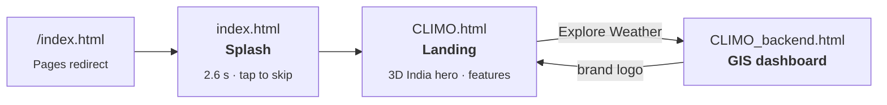
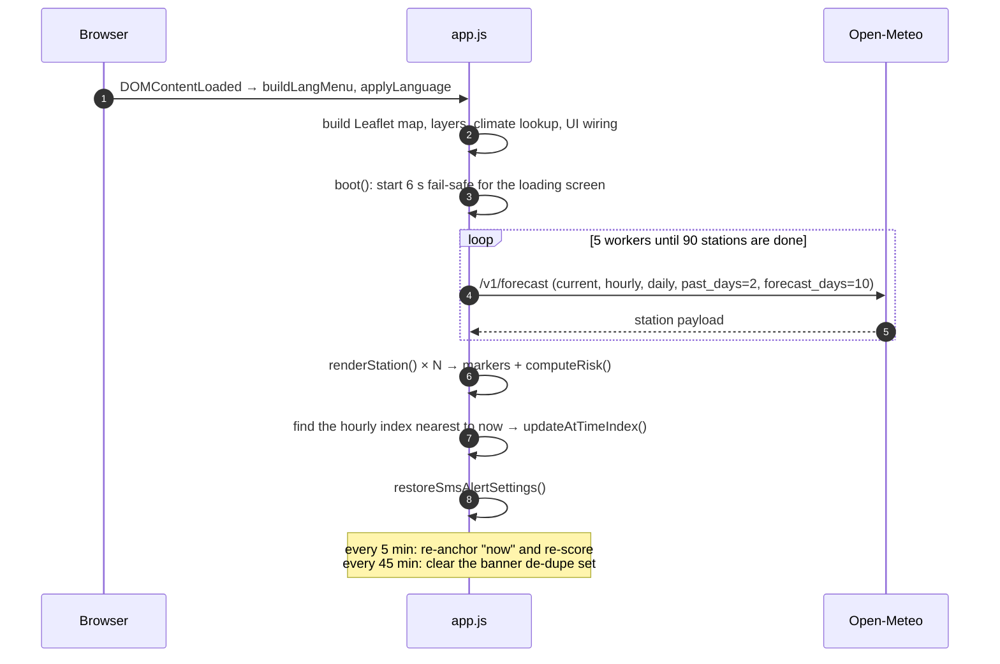

# 🏗️ Architecture

CLIMO is a **static, client-only web app**. It has no server, no bundler and no framework. Its three HTML pages load libraries from CDNs, and almost all behaviour lives in a single script, `js/app.js`. That design lets the same folder run from disk, from GitHub Pages, and inside an Android Cordova WebView.

---

## 1. Page flow

| Page | Script | Stylesheet | Purpose |
|---|---|---|---|
| `index.html` (repo root) | inline | inline | Sends GitHub Pages visitors into the app folder |
| `CLIMO-project/index.html` | `js/index.js` | `css/index.css` | Starfield splash; fades and redirects to `CLIMO.html` |
| `CLIMO.html` | `js/climo.js` | `css/climo.css` | Marketing hero: SVG India map, mouse-parallax 3D tilt, wind streams |
| `CLIMO_backend.html` | `js/app.js` | `css/app.css` | The full dashboard |

**Fonts:** Space Grotesk, Inter and JetBrains Mono (Google Fonts).
**Libraries (cdnjs):** Leaflet 1.9.4, Leaflet.markercluster 1.5.3, Leaflet.heat 0.2.0.

---

## 2. Module map of `app.js`

`app.js` is about 4,000 lines and 835 KB. About 600 KB of that is the inline `WEATHER_DATA` array on a single line. After the i18n block, the code runs inside one IIFE (`"use strict"`) that shares the Leaflet `map` instance.

| # | Module | Key symbols | Responsibility |
|:-:|---|---|---|
| 1 | **i18n** | `LANGUAGES`, `TRANSLATIONS`, `t()`, `applyLanguage()`, `buildLangMenu()` | 16 languages. Swaps `[data-i18n]` and `[data-i18n-placeholder]` text. The choice is saved in `localStorage.climoLang`. |
| 2 | **Dataset** | `WEATHER_DATA` | 2,790 rows of India Climate Pulse data, 2000–2030 (see [DATA.md](DATA.md)) |
| 3 | **Config** | `ORS_CONFIG`, `GEOCODE_URL`, `INDIA_STATIONS`, `TYPE_COLOR` | API endpoints and the 90-station network |
| 4 | **Risk palette** | `RISK_THRESHOLDS`, `riskColor()`, `riskLabel()` | One shared colour and threshold scale |
| 5 | **Base map** | `osmStandardLayer`, `satelliteLayer`, `switchBaseMap()` | OSM or Esri imagery. The view is centred on India (22.59, 78.96) at zoom 5. |
| 6 | **Atmosphere canvas** | `ATMOS_COLORS`, `drawWind/Rain/Humidity/Temperature()`, `setAtmosphere()` | A NASA-style particle animation drawn over the map for the active choropleth variable |
| 7 | **State choropleth** | `STATE_GEOJSON_URL`, `CHOROPLETHS`, `fetchLiveStateWeather()`, `FALLBACK_STATE_VALUES`, `showStateDetail()` | Colours each state by temperature, rainfall, humidity or wind. Uses **one** batched Open-Meteo call for all state centroids. If that fails, it shows clearly labelled fallback values. |
| 8 | **Stations & markers** | `typeIconSvg()`, `makeIcon()`, `buildDrawerLegend()`, `WMO`, `wmoInfo()` | Custom SVG icons for each sensor type, the WMO code table, and the legend |
| 9 | **Geo utilities** | `haversineKm()`, `findNearestStation()`, `circleToRing()` | Great-circle distance, nearest station, circle-to-polygon conversion |
| 10 | **Alerts** | `queueBanner()`, `showNextBanner()`, `maybeNativeNotify()` | A queue of in-app banners plus the browser Notification API |
| 11 | **Data fetch & risk** | `fetchStationData()`, `computeRisk()`, `parseIST()` | Open-Meteo request, flood index, and IST-safe timestamp parsing |
| 12 | **Render & timeline** | `renderStation()`, `updateAtTimeIndex()`, `renderAlerts()`, `toggleTimeExplorer()` | Markers, the rolling 24 h score, the *Top Alerts* list, and the time slider |
| 13 | **Station drawer** | `openDrawer()`, `drawNearestRoute()`, `crowdReportHtml()` | Hourly and 7-day strips, metrics, risk bar, nearest-station road route, local feedback |
| 14 | **Climate heatmap** | `CLIMATE_BY_STATION_YEAR`, `renderClimateHeatmapLive()`, `renderClimateHeatmapForYear()`, `climatePlay()` | Two modes: *live* (current readings) and *year* (2000–2030 table). Both draw to one shared `Leaflet.heat` layer. |
| 15 | **Buffer analysis** | `drawStationBuffers()`, `openBufferInsights()`, `drawCustomLocationBuffers()`, `selectCustomLocation()` | 15 km station buffers and 5/10/15/20 km location rings |
| 16 | **Route planner** | `geocodePlace()`, `sampleRouteEvery()`, `fetchRouteWeatherRisk()`, `buildStationAvoidZones()`, `callORS()`, `fetchWeatherSafeRoute()`, `renderRouteComparison()` | Weather-aware A→B routing (see [RISK_MODEL.md](RISK_MODEL.md#4-weather-safe-routing)) |
| 17 | **Map click** | `showWeatherForClickedPoint()`, `isMapClickIdle()` | Live weather for any tapped point |
| 18 | **Search** | `runSearch()`, `geoAreaSearch()`, `selectArea()`, `selectStationById()` | Matches station names and states first, then falls back to Nominatim |
| 19 | **Export** | `triggerFileDownload()`, `#downloadBtn` handler | CSV report, with a data-URI path for Android WebView |
| 20 | **CLIMO Copilot** | `executeGISCommand()`, `asstSubmit()`, `parseTimeOffset()`, `extractLocationFromQuery()`, `fetchPlaceWeather()` | Regex intent routing plus live Open-Meteo lookups. No LLM is involved. |
| 21 | **Personal alerts** | `restoreSmsAlertSettings()`, `checkMyLocationAlert()`, `sendSmsAlert()` | A phone number, threshold and watched station, saved in `localStorage.climo_sms_alert`. The SMS step is simulated. |
| 22 | **Boot** | `boot()` | Fetches stations with concurrency 5, finds the *now* index, starts the 5-minute and 45-minute timers |
| 23 | **Mobile nav** | `initMobileLayers()` (separate IIFE) | Adds a hamburger button that opens the sidebar as a drawer on small screens |

---

## 3. Boot sequence

**Resilience built in:**

- **Concurrency cap of 5.** Prevents Open-Meteo from returning `429` when 90 stations load at once.
- **6-second fail-safe.** The loader never hangs. The map always appears, even if every request fails ("No internet — map only").
- **Batched multi-point calls.** The state choropleth and the route samples each make one request, not one per point.
- **`parseIST()`.** Pins bare Open-Meteo timestamps to `+05:30`, so the timeline is correct in any browser timezone.
- **Guarded `localStorage`.** Wrapped in try/catch so sandboxed iframes and WebViews don't break boot.

---

## 4. State & storage

| Key | Where | Contents |
|---|---|---|
| `climoLang` | `localStorage` | selected language code |
| `climo_sms_alert` | `localStorage` | `{phone, threshold, stationId}` |
| `station.data / .risk / ._liveScore` | in memory | per-station payload and scores |
| `markers[id]` | in memory | `{marker, circle, station}` |

No data is sent anywhere except to the public APIs listed below. Local feedback posts are **only kept in the page**; they are not persisted or shared.

---

## 5. External services

| Service | Endpoint | Used for | Auth |
|---|---|---|---|
| Open-Meteo Forecast | `api.open-meteo.com/v1/forecast` | stations, states, route samples, Copilot, map clicks | none |
| Open-Meteo Geocoding | `geocoding-api.open-meteo.com/v1/search` | route and buffer autocomplete | none |
| Nominatim | `nominatim.openstreetmap.org/{search,reverse}` | area search, reverse geocoding | none (respect the [usage policy](https://operations.osmfoundation.org/policies/nominatim/)) |
| OpenRouteService | `api.openrouteservice.org/v2/directions/driving-car/geojson` | road routing and avoid-polygons | API key |
| jsDelivr | `geojson-india@0.0.2/india.json` | state boundaries | none |
| OSM / Esri | tile servers | base maps | none |

---

## 6. Mobile & Android

- **Responsive CSS** in `app.css`. Below the mobile breakpoint, the sidebar becomes a slide-in drawer opened by the injected `#mobileLayersToggle`. The time explorer docks at the bottom, and the language menu switches to `position: fixed`.
- **WebView-aware downloads.** `triggerFileDownload()` detects Android WebView by the `; wv)` user-agent token and opens a `data:` URI, because `blob:` links never reach Android's DownloadManager.
- **Cordova packaging** happens in CI (see [DEPLOYMENT.md](DEPLOYMENT.md)).

---

## 7. Suggested refactors

| Problem | Suggestion |
|---|---|
| `app.js` is a single 835 KB file | Split it into ES modules along the table in §2 |
| Inline 600 KB dataset | Move it to `data/climate-pulse.json` and `fetch()` it lazily when the time explorer opens |
| Inline `onclick` handlers in the HTML | Wire them in JS for a stricter CSP |
| No tests | `computeRisk`, `haversineKm`, `circleToRing`, `sampleRouteEvery` and `parseIST` are pure functions, so they are easy to unit-test |
