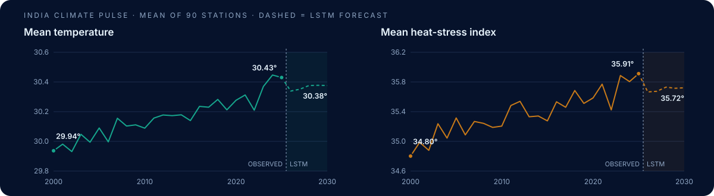

# 📊 Data

CLIMO combines two kinds of data:

| Layer | Source | Granularity | Used by |
|---|---|---|---|
| **Live** | Open-Meteo Forecast API, fetched in the browser | hourly: 48 h of history + 10-day forecast, current conditions | markers, drawer, risk, alerts, live heatmaps, choropleth, routing, Copilot |
| **Historical + forecast** | `WEATHER_DATA`, the *India Climate Pulse* table bundled inside `js/app.js` | annual, 2000–2030 | the 2000–2030 climate heatmap slider |

---

## 1. India Climate Pulse dataset (`WEATHER_DATA`)

A JSON array declared on a single line of `js/app.js`, about 600 KB. The source comment describes it as *"IMD stations + LSTM forecast"*. It was originally built for a separate `heatmap.html`, which is not in this repo.

### Shape

| Property | Value |
|---|---|
| Rows | **2,790** |
| Stations | **90** (each `Station_ID` joins 1:1 with `INDIA_STATIONS`) |
| Years | **2000 – 2030** (31 years, one row per station per year) |
| `Source = "Observed"` | 2000 – 2025 · 2,340 rows |
| `Source = "Forecast (LSTM)"` | 2026 – 2030 · 450 rows (matches `FORECAST_START_YEAR = 2026`) |

### Data dictionary

| Column | Type | Unit | Observed range | Description |
|---|---|---|---|---|
| `Station_ID` | int | – | 42026 – 50054 | WMO/IMD-style station identifier |
| `Station_Name` | string | – | – | Display name, e.g. `Mumbai (Colaba)` |
| `Latitude` | float | ° N | 8.52 – 34.15 | Station latitude |
| `Longitude` | float | ° E | 70.80 – 94.91 | Station longitude |
| `Year` | int | – | 2000 – 2030 | Calendar year |
| `Temperature_C` | float | °C | 23.0 – 32.8 | Annual temperature value |
| `Rainfall_mm` | float | mm | 847.6 – 4,445.6 | Annual rainfall total |
| `Humidity_percent` | float | % | 48.6 – 92.9 | Mean relative humidity |
| `Heat_Stress_Index_C` | float | °C | 24.62 – 46.69 | Heat-stress (feels-like) index |
| `Source` | enum | – | `Observed`, `Forecast (LSTM)` | Provenance flag |

### National trend (mean of 90 stations)



| Year | Temp °C | Rainfall mm | Humidity % | Heat-stress °C | Source |
|---:|---:|---:|---:|---:|---|
| 2000 | 29.94 | 2,031 | 67.2 | 34.80 | Observed |
| 2010 | 30.09 | 2,072 | 67.2 | 35.21 | Observed |
| 2020 | 30.28 | 2,051 | 66.6 | 35.58 | Observed |
| 2025 | 30.43 | 2,105 | 66.6 | 35.91 | Observed |
| 2030 | 30.38 | 2,028 | 67.0 | 35.72 | LSTM |

**Highlights in the table:**

- Largest warming from 2000 to 2030: **Bikaner +1.73 °C**, Udaipur +1.46 °C, Srinagar +1.44 °C, Salem +1.37 °C, Ludhiana +1.36 °C
- Highest heat-stress in 2030: **Nashik 41.9 °C**, Mumbai (Colaba) 41.6 °C, Kolhapur 41.3 °C, Pune 41.2 °C, Surat 41.1 °C
- Wettest in 2025: **Coimbatore 4,446 mm**, Salem 3,594 mm, Hubballi 3,478 mm

### How the app uses it

`CLIMATE_BY_STATION_YEAR[Station_ID][Year]` is built once at load. When the year slider moves, `renderClimateHeatmapForYear()` takes each station's value for the selected parameter, normalises it to the year-mode range, and feeds it to `Leaflet.heat`:

| Parameter | Heatmap range | Gradient |
|---|---|---|
| `Temperature_C` | 15 – 42 °C | `#1f5f7a` → `#ffb347` → `#d81f39` |
| `Humidity_percent` | 30 – 90 % | `#3a2a1a` → `#3fae9e` → `#1a7f8c` |
| `Rainfall_mm` | 200 – 3,200 mm | `#3a2a1a` → `#8fb8ff` → `#1f3fae` |

### Data-quality notes

> ⚠️ These are worth fixing before using the dataset for any analysis.

1. **Values don't match real climatology for several stations.** Some examples:

   | Station | Dataset (2000) | Typical real climate |
   |---|---|---|
   | Leh | 24.1 °C, 1,576 mm | ≈ 5 °C annual mean, ≈ 100 mm/yr (cold desert) |
   | Bikaner | 28.1 °C, 1,640 mm | ≈ 26 °C, ≈ 250–300 mm/yr (Thar desert) |
   | Shimla | 27.7 °C, 2,222 mm | ≈ 15 °C annual mean |

   Every station's temperature sits in a narrow 23–33 °C band, and every station gets at least 847 mm of rain. That suggests the series was generated or re-scaled rather than taken directly from IMD records.

2. **"Observed" may be a misleading label.** Until provenance is documented, describe 2000–2025 as *reference* data, not observations.
3. **No LSTM details.** There is no record of the training window, features, validation metrics or uncertainty. The forecast also flattens out after 2025, which is common when a model is extrapolated recursively.
4. **No state column.** The state comes from joining with `INDIA_STATIONS`.

**Suggested fix:** rebuild the layer from **IMD gridded data** (0.25° rainfall, 1° temperature) or **ERA5-Land**, sampled at station coordinates. Publish the notebook in `data/` together with the LSTM metrics (MAE/RMSE on a held-out 2019–2025 window).

---

## 2. Live data (Open-Meteo)

Requested for each station in `fetchStationData()`:

| Block | Variables |
|---|---|
| `current` | `temperature_2m`, `relative_humidity_2m`, `precipitation`, `wind_speed_10m`, `weathercode` |
| `hourly` | `temperature_2m`, `precipitation`, `weathercode`, `precipitation_probability` |
| `daily` | `weathercode`, `temperature_2m_max/min`, `precipitation_sum`, `precipitation_probability_max` |
| options | `past_days=2`, `forecast_days=10`, `timezone=Asia/Kolkata` |

The state choropleth adds `wind_direction_10m` and `apparent_temperature`. All state centroids go in **one** comma-separated multi-location request.

Weather codes follow the **WMO 4677** subset that Open-Meteo uses. The app maps 26 codes to labels and emoji (`WMO` table): 0 clear → 99 severe thunderstorm.

---

## 3. Station network (`INDIA_STATIONS`)

**90 stations · 33 states and union territories · 4 sensor types**

| Type | Count | Marker colour |
|---|---:|---|
| 🛰️ AWS (automatic weather station) | 35 | `#5B8DEF` |
| 🌧️ Rain gauge | 24 | `#4FD9D0` |
| 🌊 River gauge | 19 | `#8B7CF6` |
| 📡 Radar | 12 | `#F2A65A` |

Coverage per state: Uttar Pradesh 8 · Gujarat, Karnataka, Maharashtra, Rajasthan 6 each · Andhra Pradesh, Tamil Nadu 5 each · Kerala, Telangana, West Bengal 4 each · Bihar, Jharkhand, Madhya Pradesh, Odisha 3 each · Assam, Delhi, Goa, Jammu & Kashmir, Punjab 2 each · 14 others 1 each.

> The `type` field is used for the icon and legend. It describes the role each location plays in the app; it is not a verified inventory of IMD hardware at that site.

<details>
<summary><b>📋 Full station catalogue (90)</b></summary>

| # | Station | State / UT | Type | WMO/IMD ID | Lat, Lon |
|---:|---|---|---|---|---|
| 1 | Port Blair | Andaman & Nicobar | 📡 Radar | `43333` | 11.62, 92.73 |
| 2 | Guntur | Andhra Pradesh | 🛰️ AWS | `50020` | 16.31, 80.44 |
| 3 | Nellore | Andhra Pradesh | 🌧️ Rain gauge | `50021` | 14.44, 79.99 |
| 4 | Tirupati | Andhra Pradesh | 🛰️ AWS | `43125` | 13.63, 79.42 |
| 5 | Vijayawada | Andhra Pradesh | 🌊 River gauge | `43156` | 16.51, 80.65 |
| 6 | Visakhapatnam | Andhra Pradesh | 📡 Radar | `43150` | 17.69, 83.22 |
| 7 | Itanagar | Arunachal Pradesh | 🌊 River gauge | `50040` | 27.08, 93.61 |
| 8 | Dibrugarh | Assam | 🌊 River gauge | `42419` | 27.47, 94.91 |
| 9 | Guwahati | Assam | 📡 Radar | `42410` | 26.11, 91.59 |
| 10 | Gaya | Bihar | 🌧️ Rain gauge | `42734` | 24.80, 85.00 |
| 11 | Patna | Bihar | 🌊 River gauge | `42724` | 25.59, 85.14 |
| 12 | Patna (Danapur) | Bihar | 🛰️ AWS | `50051` | 25.63, 85.05 |
| 13 | Chandigarh | Chandigarh | 🛰️ AWS | `42111` | 30.73, 76.78 |
| 14 | Raipur | Chhattisgarh | 🛰️ AWS | `42971` | 21.25, 81.63 |
| 15 | New Delhi (Palam) | Delhi | 📡 Radar | `50048` | 28.57, 77.10 |
| 16 | New Delhi (Safdarjung) | Delhi | 🛰️ AWS | `42182` | 28.58, 77.21 |
| 17 | Margao | Goa | 🌧️ Rain gauge | `50044` | 15.28, 73.99 |
| 18 | Panaji | Goa | 🛰️ AWS | `43201` | 15.49, 73.83 |
| 19 | Ahmedabad | Gujarat | 📡 Radar | `42830` | 23.02, 72.57 |
| 20 | Ahmedabad (Gandhinagar) | Gujarat | 🛰️ AWS | `50054` | 23.22, 72.64 |
| 21 | Bhavnagar | Gujarat | 🌊 River gauge | `50031` | 21.76, 72.15 |
| 22 | Rajkot | Gujarat | 🛰️ AWS | `50029` | 22.30, 70.80 |
| 23 | Surat | Gujarat | 🌊 River gauge | `42875` | 21.17, 72.83 |
| 24 | Vadodara | Gujarat | 📡 Radar | `50030` | 22.31, 73.18 |
| 25 | Shimla | Himachal Pradesh | 🌧️ Rain gauge | `42055` | 31.10, 77.17 |
| 26 | Jammu | Jammu & Kashmir | 🛰️ AWS | `50045` | 32.73, 74.86 |
| 27 | Srinagar | Jammu & Kashmir | 🛰️ AWS | `42027` | 34.08, 74.80 |
| 28 | Dhanbad | Jharkhand | 🛰️ AWS | `50033` | 23.80, 86.43 |
| 29 | Jamshedpur | Jharkhand | 🌊 River gauge | `50032` | 22.80, 86.20 |
| 30 | Ranchi | Jharkhand | 🌊 River gauge | `42700` | 23.34, 85.31 |
| 31 | Belagavi | Karnataka | 🌊 River gauge | `50009` | 15.85, 74.50 |
| 32 | Bengaluru (Whitefield) | Karnataka | 🌧️ Rain gauge | `50049` | 12.97, 77.75 |
| 33 | Bengaluru City | Karnataka | 🛰️ AWS | `43257` | 12.97, 77.59 |
| 34 | Hubballi | Karnataka | 🌧️ Rain gauge | `50007` | 15.36, 75.12 |
| 35 | Mangaluru | Karnataka | 📡 Radar | `50008` | 12.91, 74.86 |
| 36 | Mysuru | Karnataka | 🛰️ AWS | `50006` | 12.30, 76.64 |
| 37 | Kochi | Kerala | 📡 Radar | `43314` | 9.93, 76.27 |
| 38 | Kozhikode | Kerala | 🌧️ Rain gauge | `43285` | 11.26, 75.78 |
| 39 | Thiruvananthapuram | Kerala | 🌧️ Rain gauge | `43708` | 8.48, 76.95 |
| 40 | Thrissur | Kerala | 🌊 River gauge | `50016` | 10.53, 76.21 |
| 41 | Leh | Ladakh | 🛰️ AWS | `42026` | 34.15, 77.58 |
| 42 | Bhopal | Madhya Pradesh | 🛰️ AWS | `42634` | 23.26, 77.41 |
| 43 | Indore | Madhya Pradesh | 🛰️ AWS | `42667` | 22.72, 75.86 |
| 44 | Jabalpur | Madhya Pradesh | 🌧️ Rain gauge | `42623` | 23.18, 79.99 |
| 45 | Chhatrapati Sambhajinagar | Maharashtra | 🛰️ AWS | `50005` | 19.88, 75.34 |
| 46 | Kolhapur | Maharashtra | 🌊 River gauge | `50004` | 16.70, 74.24 |
| 47 | Mumbai (Colaba) | Maharashtra | 🛰️ AWS | `43003` | 18.90, 72.81 |
| 48 | Nagpur | Maharashtra | 📡 Radar | `43057` | 21.15, 79.09 |
| 49 | Nashik | Maharashtra | 🌧️ Rain gauge | `50003` | 20.00, 73.79 |
| 50 | Pune | Maharashtra | 🛰️ AWS | `43192` | 18.52, 73.86 |
| 51 | Imphal | Manipur | 🛰️ AWS | `50038` | 24.82, 93.94 |
| 52 | Shillong | Meghalaya | 🌧️ Rain gauge | `42515` | 25.58, 91.89 |
| 53 | Aizawl | Mizoram | 🌧️ Rain gauge | `50039` | 23.73, 92.72 |
| 54 | Kohima | Nagaland | 🌧️ Rain gauge | `50041` | 25.68, 94.11 |
| 55 | Bhubaneswar | Odisha | 📡 Radar | `43053` | 20.30, 85.82 |
| 56 | Cuttack | Odisha | 🌊 River gauge | `50034` | 20.46, 85.88 |
| 57 | Sambalpur | Odisha | 🌧️ Rain gauge | `50035` | 21.47, 83.98 |
| 58 | Puducherry | Puducherry | 🛰️ AWS | `50046` | 11.94, 79.81 |
| 59 | Amritsar | Punjab | 🌧️ Rain gauge | `42071` | 31.63, 74.87 |
| 60 | Ludhiana | Punjab | 🌧️ Rain gauge | `42101` | 30.90, 75.86 |
| 61 | Bikaner | Rajasthan | 🌧️ Rain gauge | `50028` | 28.02, 73.31 |
| 62 | Jaipur | Rajasthan | 🛰️ AWS | `42339` | 26.91, 75.79 |
| 63 | Jaipur (Sanganer) | Rajasthan | 🌧️ Rain gauge | `50052` | 26.82, 75.80 |
| 64 | Jodhpur | Rajasthan | 📡 Radar | `42260` | 26.24, 73.02 |
| 65 | Kota | Rajasthan | 🌊 River gauge | `50027` | 25.21, 75.86 |
| 66 | Udaipur | Rajasthan | 🛰️ AWS | `50026` | 24.59, 73.71 |
| 67 | Gangtok | Sikkim | 🌊 River gauge | `50042` | 27.34, 88.61 |
| 68 | Chennai (Nungambakkam) | Tamil Nadu | 🛰️ AWS | `43279` | 13.07, 80.24 |
| 69 | Coimbatore | Tamil Nadu | 🛰️ AWS | `43290` | 11.02, 76.96 |
| 70 | Madurai | Tamil Nadu | 🌧️ Rain gauge | `43284` | 9.93, 78.12 |
| 71 | Salem | Tamil Nadu | 🌊 River gauge | `50013` | 11.66, 78.15 |
| 72 | Tiruchirappalli | Tamil Nadu | 🌧️ Rain gauge | `50012` | 10.79, 78.70 |
| 73 | Hyderabad (Begumpet) | Telangana | 📡 Radar | `43128` | 17.45, 78.47 |
| 74 | Hyderabad (Shamshabad) | Telangana | 🛰️ AWS | `50050` | 17.24, 78.43 |
| 75 | Nizamabad | Telangana | 🌧️ Rain gauge | `50018` | 18.67, 78.09 |
| 76 | Warangal | Telangana | 🛰️ AWS | `50017` | 17.97, 79.59 |
| 77 | Agartala | Tripura | 🛰️ AWS | `42295` | 23.83, 91.29 |
| 78 | Agra | Uttar Pradesh | 🛰️ AWS | `50022` | 27.18, 78.01 |
| 79 | Gorakhpur | Uttar Pradesh | 🌊 River gauge | `50025` | 26.76, 83.37 |
| 80 | Kanpur | Uttar Pradesh | 🛰️ AWS | `42361` | 26.45, 80.33 |
| 81 | Lucknow (Amausi) | Uttar Pradesh | 🛰️ AWS | `42369` | 26.76, 80.89 |
| 82 | Lucknow (Gomti Nagar) | Uttar Pradesh | 🌧️ Rain gauge | `50053` | 26.85, 81.00 |
| 83 | Meerut | Uttar Pradesh | 🌧️ Rain gauge | `50023` | 28.98, 77.71 |
| 84 | Prayagraj | Uttar Pradesh | 🌊 River gauge | `50024` | 25.44, 81.85 |
| 85 | Varanasi | Uttar Pradesh | 🌊 River gauge | `42367` | 25.32, 82.97 |
| 86 | Dehradun | Uttarakhand | 🌧️ Rain gauge | `42165` | 30.32, 78.03 |
| 87 | Durgapur | West Bengal | 🛰️ AWS | `50037` | 23.52, 87.31 |
| 88 | Kolkata (Alipore) | West Bengal | 🛰️ AWS | `42807` | 22.53, 88.32 |
| 89 | Kolkata (Salt Lake) | West Bengal | 🛰️ AWS | `42810` | 22.57, 88.40 |
| 90 | Siliguri | West Bengal | 🌊 River gauge | `50036` | 26.73, 88.40 |

</details>

---

## 4. Export format

**Export Report** downloads `weather-report-YYYY-MM-DD.csv` (UTF-8 with BOM, so Excel opens it correctly):

```text
CLIMO — Today's Weather Report
Generated, <timestamp>
Source, Open-Meteo forecast API

Station, State, Temp (°C), Humidity (%), Rain (mm), Wind (km/h), Flood Risk, Risk Score (/100)
...
Total stations, <n>
```
