

# 🖼️ CLIMO Gallery

**Every screen of CLIMO: desktop, mobile, light map and dark atmosphere.**

<a href="#first-impressions">First impressions</a> ·
<a href="#observatory">Observatory</a> ·
<a href="#gis-layers">GIS layers</a> ·
<a href="#decision-tools">Decision tools</a> ·
<a href="#mobile">Mobile</a>

---

## 🌌 First impressions

<table>
<tr>
<td width="50%">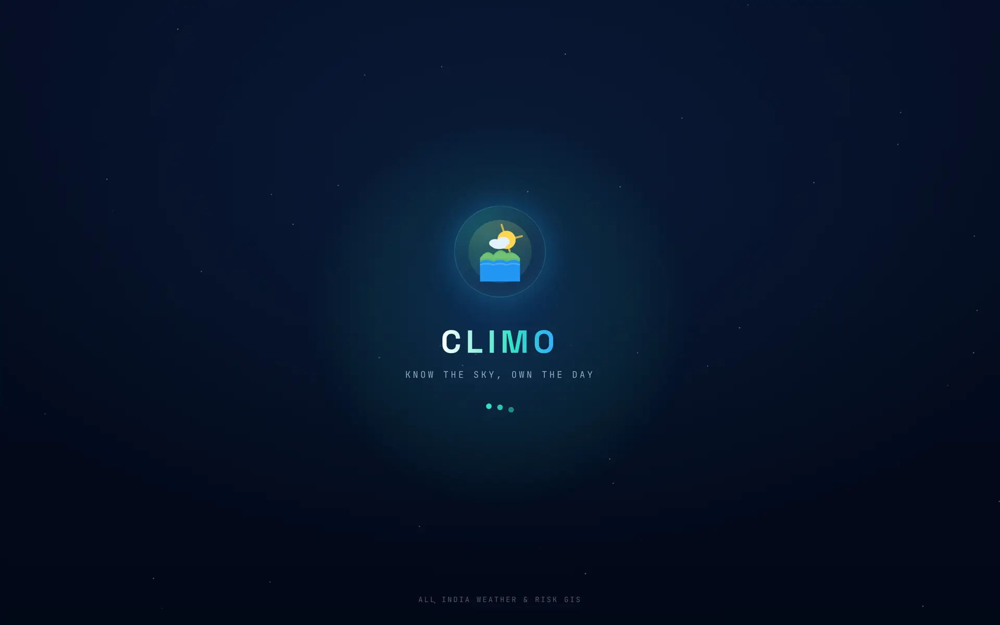</td>
<td width="50%">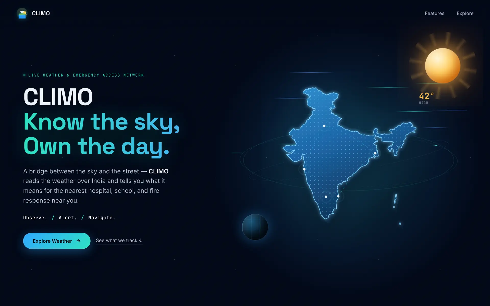</td>
</tr>
<tr>
<td valign="top"><b>01 · Splash</b> A twinkling starfield, the animated sun-cloud-land-water logo, and the tagline <i>Know the sky, Own the day</i>. It moves on after 2.6 s, or you can tap to skip.</td>
<td valign="top"><b>02 · Landing hero</b> A glowing, dot-textured 3D India with live city pins (New Delhi, Mumbai, Kolkata, Chennai, Bengaluru), orbiting energy rings, a 3D sun and wind streams. The scene tilts with your mouse.</td>
</tr>
<tr>
<td>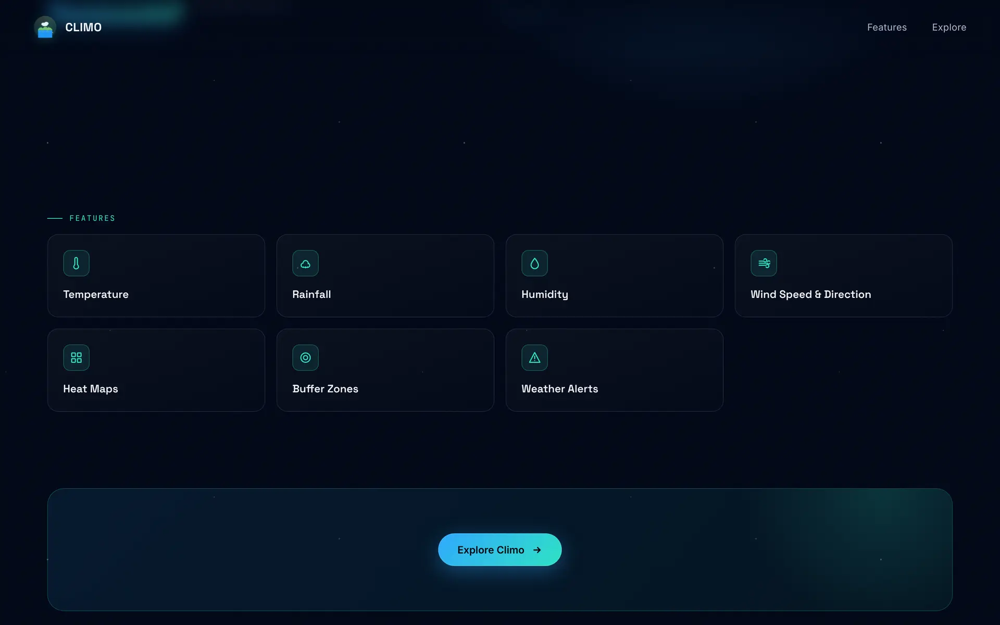</td>
<td>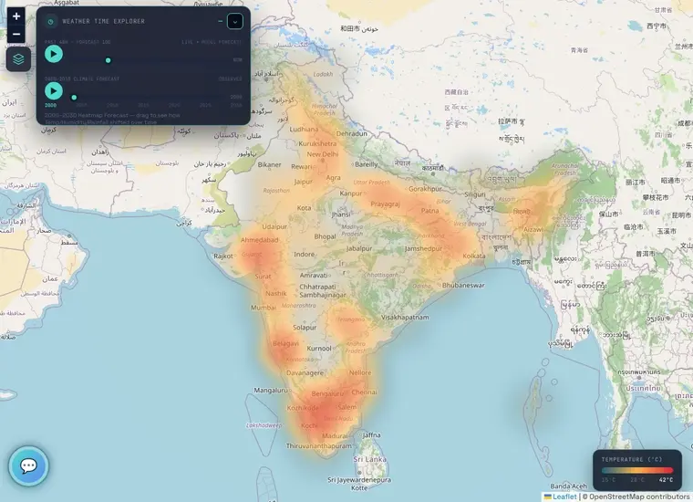</td>
</tr>
<tr>
<td valign="top"><b>03 · What we track</b> Temperature, rainfall, humidity, wind, heat maps, buffer zones and weather alerts, followed by the <i>Explore Climo</i> call-to-action.</td>
<td valign="top"><b>✨ Time-lapse · 2000 → 2030</b> The temperature heatmap stepping through every year of the bundled India Climate Pulse dataset. From 2026 the slider label changes to <code>FORECAST (LSTM)</code>.</td>
</tr>
</table>

---

## 🛰️ The observatory

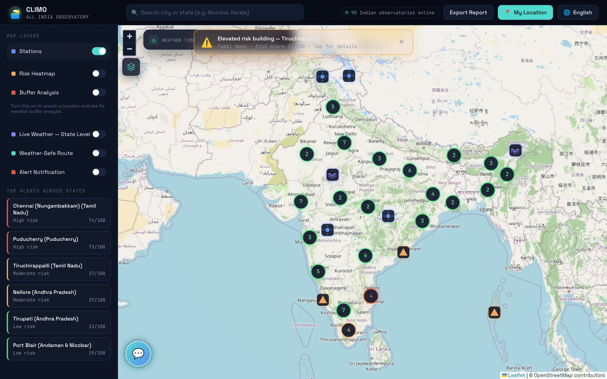

**04 · All-India observatory.** 90 stations clustered on the map, each with an icon for its sensor type (AWS, radar, rain gauge, river gauge). The sidebar ranks the *Top Alerts Across States* by live risk score. A banner slides in when a station crosses the Moderate threshold.

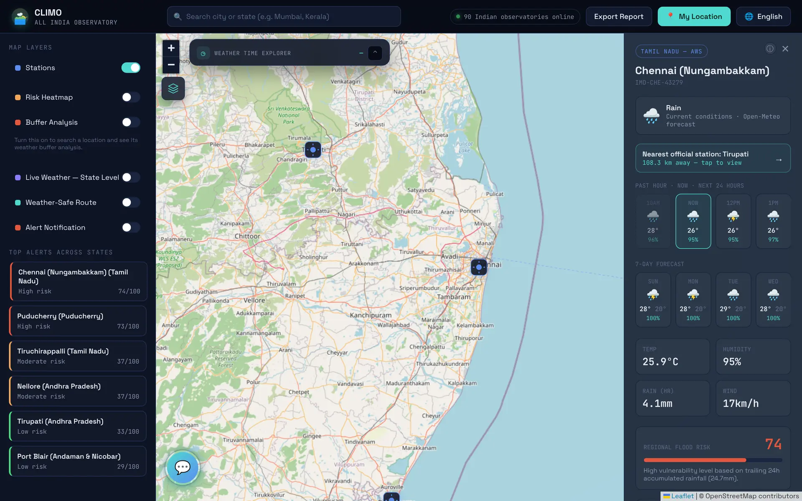

**05 · Station drawer.** Click any station or alert card to see current conditions, the nearest other station (tap it for a road route), a strip covering the past hour, now and the next 24 hours, a 7-day forecast, temperature, humidity, rain and wind tiles, a **Regional Flood Risk** bar, and a *Local feedback* box for residents.

---

## 🗺️ GIS layers

<table>
<tr>
<td width="50%">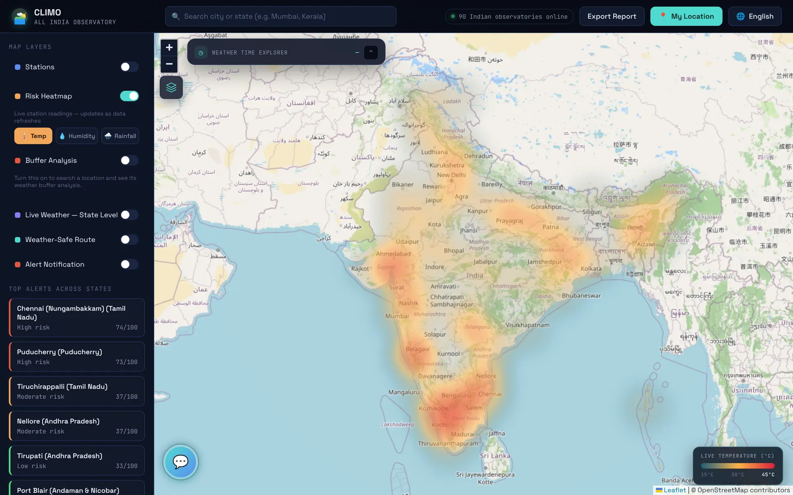</td>
<td width="50%">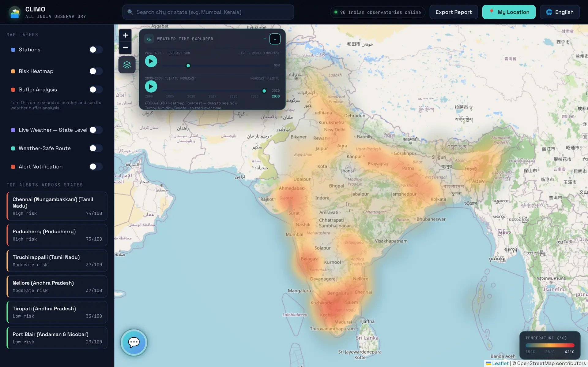</td>
</tr>
<tr>
<td valign="top"><b>06 · Live heatmap</b> Under <i>Risk Heatmap</i>, choose Temp, Humidity or Rainfall to see a <code>Leaflet.heat</code> surface built from each station's current reading, with a colour-bar legend.</td>
<td valign="top"><b>07 · Climate year 2030</b> Open the <i>Weather Time Explorer</i>. Its top slider scrubs 48 h of history plus 10 days of forecast. The bottom slider plays the 2000 → 2030 annual heatmap.</td>
</tr>
<tr>
<td>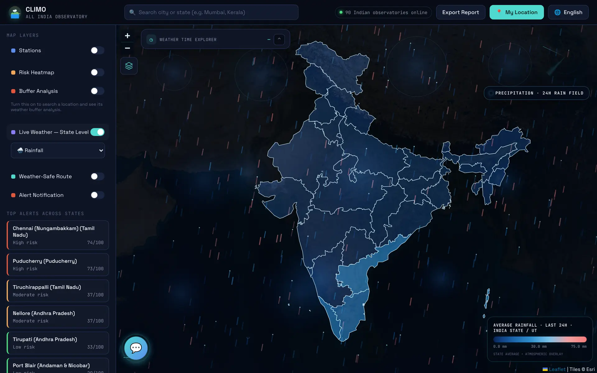</td>
<td>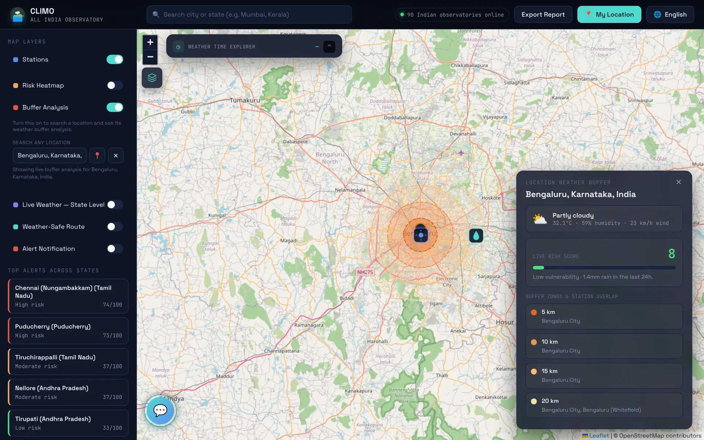</td>
</tr>
<tr>
<td valign="top"><b>08 · State-level choropleth</b> Live 24 h rainfall for each state over a dark satellite base, with a NASA-style animated rain canvas. Temperature, humidity and wind modes each have their own particle effect.</td>
<td valign="top"><b>09 · Buffer analysis</b> Search any place to get 5/10/15/20 km risk rings and a <i>Location Weather Buffer</i> card that shows live conditions, a risk score and which stations fall inside each ring.</td>
</tr>
</table>

---

## 🧭 Decision tools

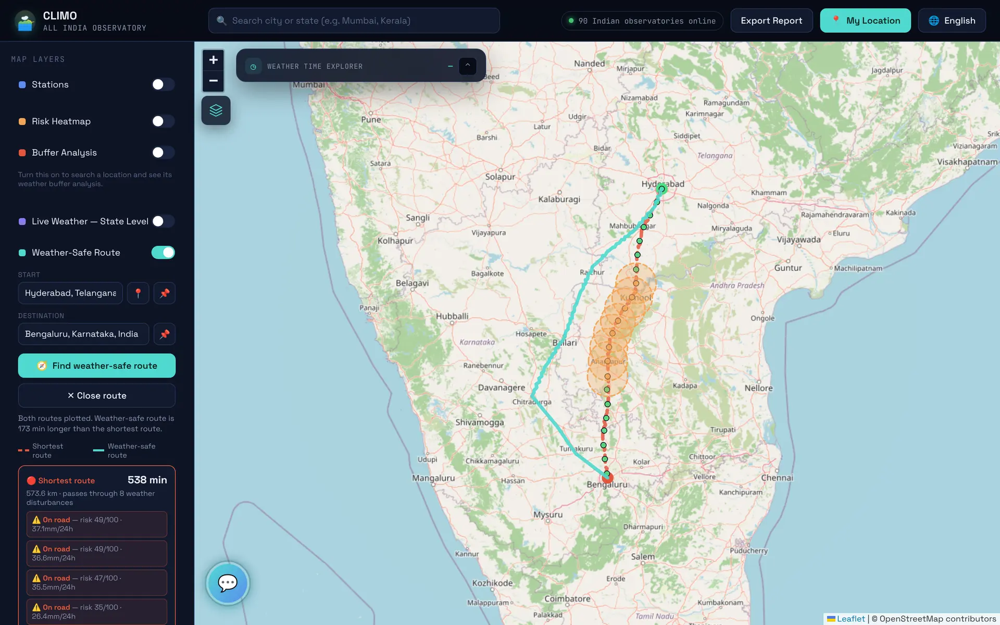

**10 · Weather-safe route, Hyderabad → Bengaluru.** CLIMO first draws the shortest road route (red, dashed). It then samples rainfall every 25 km (the coloured dots) and marks storm cells as avoid-zones (orange circles). Finally it asks OpenRouteService for a detour, shown in teal. A side-by-side card compares the two routes' time, distance and the hazards they pass through.

<table>
<tr>
<td width="50%">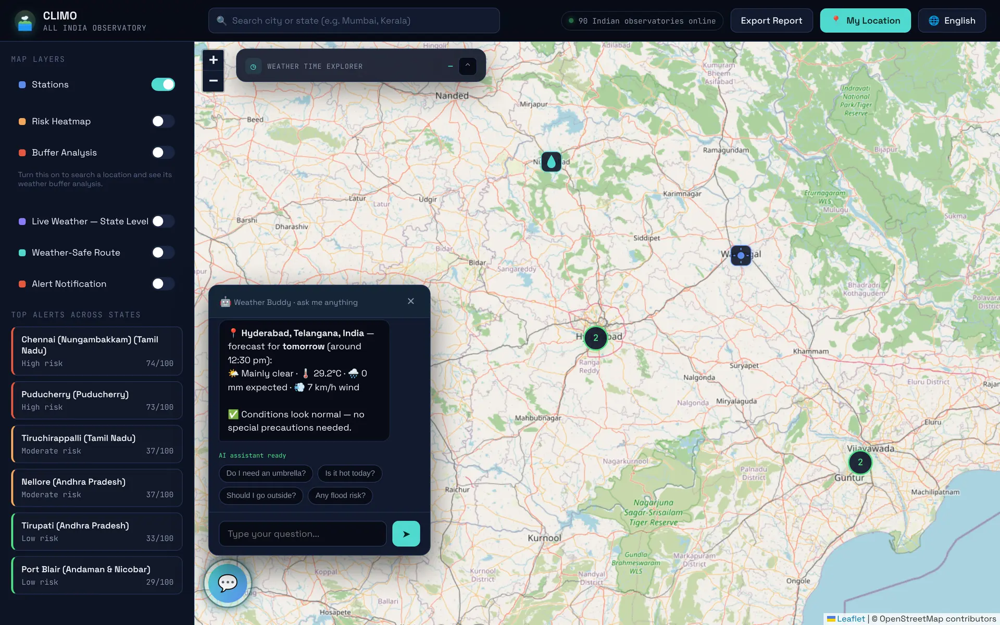</td>
<td width="50%">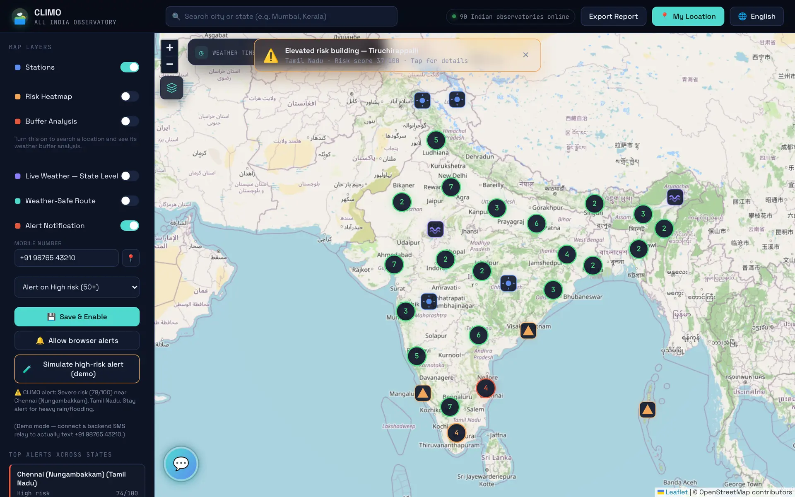</td>
</tr>
<tr>
<td valign="top"><b>11 · CLIMO Copilot</b> A chat assistant that runs in the browser. It understands places, "near me" and time phrases such as <i>in 2 hours</i>, <i>tonight</i> and <i>tomorrow</i>. It answers with live forecasts and practical advice, and needs no LLM or API key.</td>
<td valign="top"><b>12 · Alert notifications</b> Enter a phone number, find your nearest station with GPS, pick a threshold (34 / 50 / 66), then save. The demo button runs the whole pipeline: banner, native notification and the SMS step (simulated).</td>
</tr>
</table>

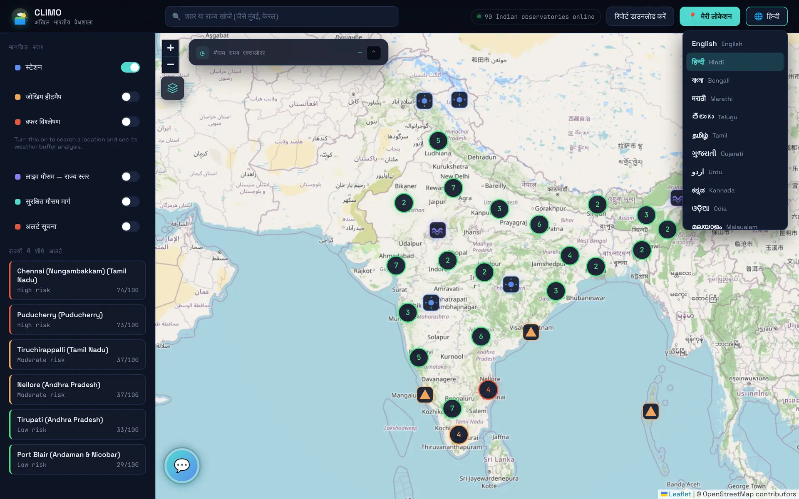

**13 · 16 Indian languages.** The language menu switches every labelled control at once. Shown here in हिन्दी, with Bengali, Marathi, Telugu, Tamil, Gujarati, Urdu, Kannada, Odia, Malayalam, Punjabi, Assamese, Maithili, Sanskrit and Konkani also available.

---

## 📱 Mobile

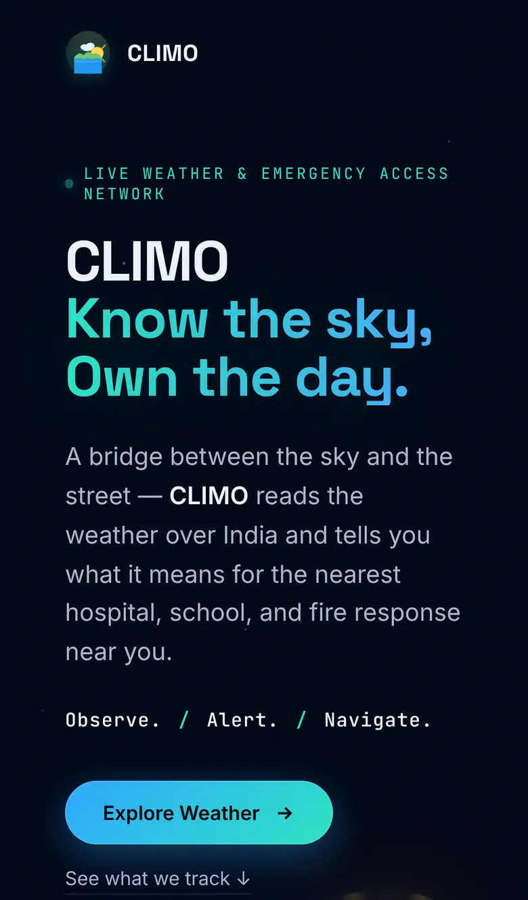&nbsp;
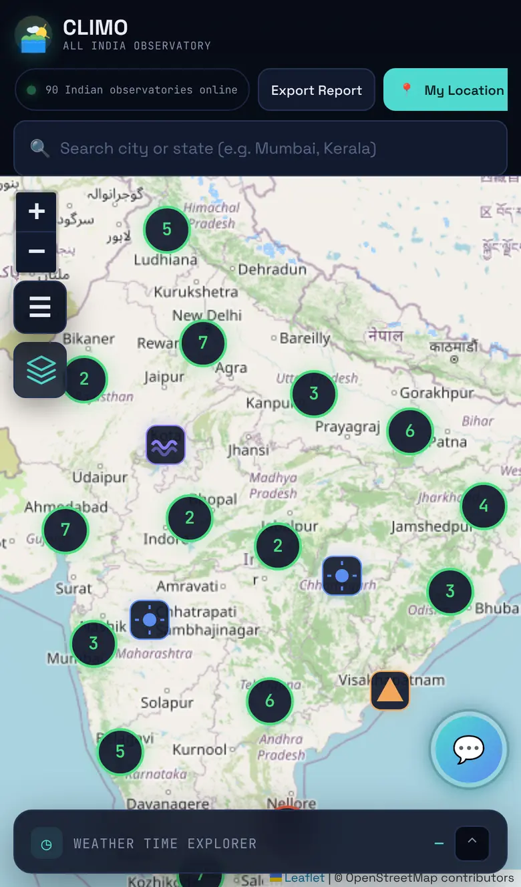&nbsp;
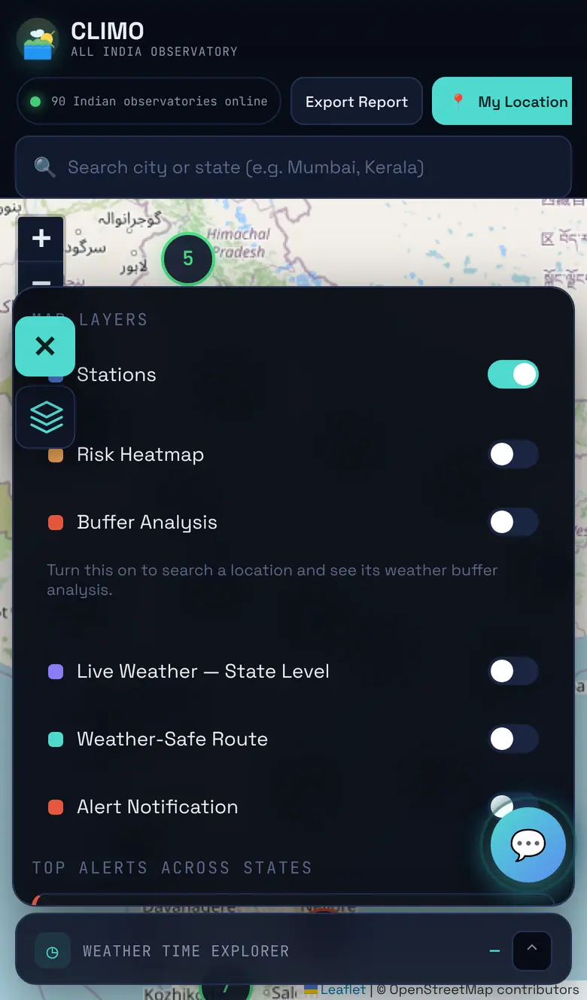

**14–16 · One responsive app.** The landing hero reflows into a single column. On the dashboard, the toolbar wraps, the search goes full-width, a ☰ button opens the layers drawer, the time explorer docks at the bottom, and the Copilot floats in the corner. The Android APK built by CI shows this same layout inside a WebView.

---

## How these screenshots were made

The screenshots were taken from the **real, unmodified app** in headless Chromium (Playwright): 1440×900 at 2× for desktop and an emulated iPhone 13 for mobile. They were then compressed to WebP.

When they were taken, Open-Meteo's free tier was **rate-limited** for the capture machine, and OpenRouteService was unreachable from it. So the network calls to those two APIs were answered with a **deterministic fixture** in the same JSON shape:

- **Weather:** a late-November pattern, with the north-east monsoon over the Tamil Nadu coast and a storm cell near Kurnool–Anantapur.
- **Routing:** road-shaped paths along NH44 and a western detour through Bellary and Chitradurga.

Everything else is live: map tiles, state boundaries, the 2000–2030 dataset, and all of the app's own UI, risk logic, buffers and routing logic. **The numbers in the screenshots are illustrative, not real observations.**
