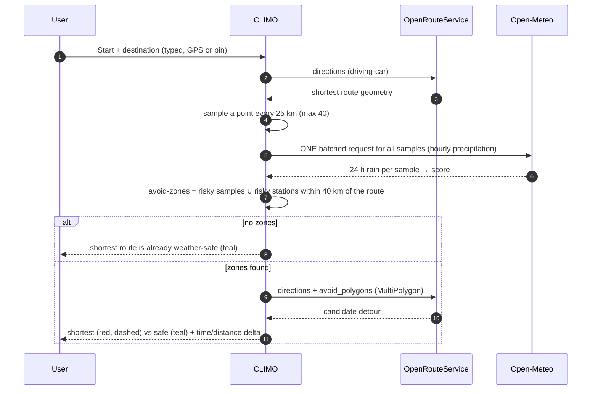

# 🌊 Risk model

CLIMO uses three related spatial models, and they all share one colour scale:

1. the **station flood-risk index**, a multi-factor score from 0 to 100
2. **buffer zones** around risky stations and around places you search
3. **route avoid-zones** used by the weather-safe router

> **Scope.** This is an *operational screening index* built only from weather variables. It is **not** a hydrodynamic or hydrological flood model. It does not use terrain, drainage, soil moisture or river stage. Use it to decide what to look at, not as an official warning.

All values below are taken directly from `CLIMO-fixed/CLIMO-project/js/app.js`.

---

## 1. Station flood-risk index

Function: `computeRisk(hourlyRain, current, daily)`

### Inputs (Open-Meteo, `timezone=Asia/Kolkata`)

| Symbol | Source field | Window |
|---|---|---|
| `R24` | `hourly.precipitation` | sum of the last 24 hourly values |
| `R6` | `hourly.precipitation` | sum of the last 6 hourly values |
| `Rnow` | `current.precipitation` | current hour (mm) |
| `P` | `daily.precipitation_probability_max[0]` | today's maximum probability (%) |
| `W` | `current.weathercode` | WMO weather code |

### Formula

Each input is normalised to 0–1 using a saturation cap, then weighted:

| Term | Normalisation | Weight |
|---|---|---:|
| 24 h accumulation | `min(R24 / 75 mm, 1)` | **45** |
| 6 h burst | `min(R6 / 35 mm, 1)` | **25** |
| Current intensity | `min(Rnow / 8 mm, 1)` | **10** |
| Rain probability | `min(P / 80 %, 1)` | **15** |
| Convective signal | `1` for WMO 95/96/99 (thunderstorm), `0.5` for 80/81/82 (showers), else `0` | **5** |

```text
score = round( clamp( 45·n24 + 25·n6 + 10·nNow + 15·nP + 5·nStorm , 0, 100 ) )
```

**Why these caps?** 75 mm in 24 h is close to IMD's *heavy rainfall* threshold of 64.5 mm/day, so a station reaches full weight as it enters heavy rain. 35 mm in 6 h is an intense, flash-flood-type burst.

### Worked example

Suppose Chennai has `R24 = 24.7 mm`, `R6 = 14.2 mm`, `Rnow = 4.1 mm`, `P = 100 %`, and WMO code `63` (rain):

```text
45·(24.7/75) + 25·(14.2/35) + 10·(4.1/8) + 15·1 + 5·0
= 14.8 + 10.1 + 5.1 + 15 + 0  =  45  →  Moderate
```

### Risk bands

The single source of truth is `RISK_THRESHOLDS = { moderate: 34, high: 66 }`.

| Score | Label | Colour | Used for |
|:-:|:-:|:-:|---|
| 0 – 33 | Low | `#4ADE80` | markers, drawer, alert cards |
| 34 – 65 | Moderate | `#F2A65A` | + banner, + buffer, + route avoid-zone |
| 66 – 100 | High | `#E4573D` | same as Moderate, with high-severity styling |

---

## 2. Time-explorer score (rolling window)

When you drag the **Weather Time Explorer** slider, `updateAtTimeIndex(idx)` recomputes a simpler, **rain-only** score for each station at that hour:

```text
liveScore = min( round( Σ precipitation[idx−23 … idx] / 75 × 100 ), 100 )
```

This `_liveScore` replaces the multi-factor score in markers, the alert list, buffers, alerts and the route planner. At boot and every 5 minutes, the slider index snaps to the hour closest to *now* (`nowIndexGlobal`).

| Rule | Threshold |
|---|---|
| Listed in *Top Alerts Across States* | `liveScore ≥ 20` (top 6 shown) |
| Banner, plus native notification if permitted | `liveScore ≥ 34`, only at the *now* index. Each station banners once, and the list resets every **45 min**. |
| Personal SMS/notification alert | `liveScore ≥` your threshold (34 / 50 / 66), and only when the score rises above the last alerted value |

> **Note.** After the first time-index update, the drawer and alerts show the rolling rain-only score, not the multi-factor index. This is intentional, so the history and forecast slider stays consistent. Still, keep it in mind when you compare numbers.

---

## 3. Buffer analysis

### Station buffers

- A buffer is drawn around every station with `score ≥ 34`.
- Fixed radius: **15 km**. Style: dashed, coloured by risk band.
- Kanpur and Lucknow are excluded on purpose (`BUFFER_EXCLUDED_NAMES`).
- Clicking a buffer opens **Buffer Insights**: radius, impacted area `π·r²` (≈ 707 km²), and the number of other stations inside the circle (haversine distance).

### Location buffers

Search any place, or use GPS. CLIMO fetches live weather for that exact point, scores it, and draws **four concentric rings**:

| Ring | Fill opacity | Colour |
|---:|---:|---|
| 20 km | 0.14 | `#FFDDB3` |
| 15 km | 0.20 | `#FFB870` |
| 10 km | 0.27 | `#F2914A` |
| 5 km | 0.34 | `#E4671E` |

The insights card lists which stations fall inside each ring.

---

## 4. Weather-safe routing

Function: `fetchWeatherSafeRoute()`



| Parameter | Value |
|---|---|
| Sampling interval | every **25 km** along the real road geometry, capped at **40** samples |
| Sample score | `min(round(R24 / 75 × 100), 100)`, the rain-only score |
| Station corridor | stations count only if within **40 km** of a sample point |
| Avoid threshold | `score ≥ RISK_THRESHOLDS.moderate` (34) |
| Station zone radius | `20 km + score × 0.5 km` |
| Road-sample zone radius | `15 km + score × 0.4 km` |
| Polygonisation | 16-segment circle (`circleToRing`), with longitude scaled by `cos(lat)` |
| "Real detour" test | the safe route is shown only if its length differs from the shortest by **> 500 m** (ORS silently returns the same path when no detour exists) |

Each sampled point is drawn as a small dot coloured by risk, so you can *see* that the whole corridor was checked. Each avoid-zone has a tooltip that explains why it was flagged.

---

## 5. Known limitations

- **Weather-only.** It ignores elevation, drainage, impervious surfaces, soil saturation and river levels.
- **Fixed caps.** 75 mm/24 h works well for the plains, but caps tuned per region (e.g. Konkan coast vs. Thar) would be more accurate.
- **Point samples.** Buffers and zones are circles around points, not catchments.
- **Forecast-dependent.** Future hours depend on Open-Meteo's model blend.

Ideas for improvement are listed in the [README roadmap](../README.md#roadmap).
